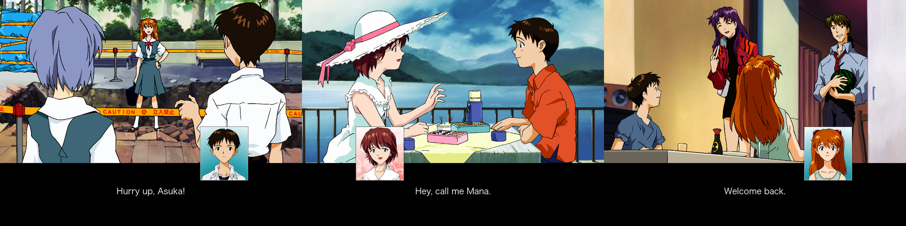

**Fantatech** is an open-source engine for [Neon Genesis Evangelion: Girlfriend of Steel - Special Edition (2006, PC)](https://vndb.org/r1152).



## About

The official PC release of Girlfriend of Steel is basically impossible to find and doesn't run on modern systems due to [SafeDisc](https://en.wikipedia.org/wiki/SafeDisc) DRM. This project implements a drop-in replacement engine that runs on Windows, macOS, and Linux.

⚠️ Full transparency: Most of the code in this repo was written by LLMs. If that's a dealbreaker, consider checking out [xPearse's English translation](https://pearsehillock.blogspot.com/2015/12/neon-genesis-evangelion-girlfriend-of_18.html) from 2015 in a Windows XP VM with GPU acceleration.

⚠️ This project is still in development. The game is fully playable, but bugs may occur. Please report them.

## Playing

1. Download the [latest release](https://github.com/fantatech-dev/fantatech/releases/latest) for Windows or Linux and unpack it.
2. Download the original game disc, [IRON MAIDEN.iso](https://archive.org/download/fantatech/IRON%20MAIDEN.iso).
3. Install the game from the disc: on Windows, drag the ISO onto `fantatech.exe`; on Linux, run `./fantatech --install "IRON MAIDEN.iso"`. This unpacks the game into a `mana01` folder next to fantatech.
4. Start fantatech.

### English Translation

Fantatech comes with an English translation (`i18n/en+llm.txt`). It is machine-translated and has not been fully proofread. Corrections and new languages are welcome; see [i18n/README.md](i18n/README.md).

### Saves

Esc opens the menu, where you can save at any time. The game resumes from save points: its command menus and the start of each chapter. Saving anywhere else saves the last save point you passed.

Saves and settings are kept in your user folder:

- Windows: `%APPDATA%\fantatech\kotetsu\`
- macOS: `~/Library/Application Support/fantatech/kotetsu/`
- Linux: `~/.local/share/fantatech/kotetsu/`

The game starts in fullscreen. F11 switches between fullscreen and a window, and so does the Fullscreen box in the settings; the choice is remembered.

F2 saves a screenshot of the game (at its own 1024×768, without the window) as a PNG in `screenshots/`, next to the `save/` folder.

## Security

Release builds are made by GitHub Actions from the tagged source, never on a personal machine. Each download has a signed attestation that proves which commit and workflow built it. With the [GitHub CLI](https://cli.github.com):

```
gh attestation verify fantatech-v0.1.0-windows-x64.zip --repo fantatech-dev/fantatech
```

The release also lists every file's SHA-256 in `SHA256SUMS.txt`.

## Contributing

Code and translation contributions are welcome. See [docs/BUILDING.md](docs/BUILDING.md) and [i18n/README.md](i18n/README.md).

## License

Fantatech is available under the terms of the GPLv3 license.

Release builds include SDL and SDL_ttf (zlib license), FreeType (FreeType License) and HarfBuzz (MIT); their licenses are in the `licenses/` folder of each download.
